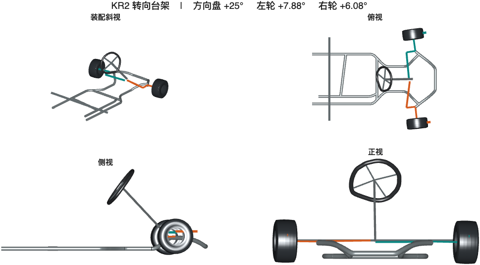

# KR2：方向盘与两只前轮

**结论：适合做几何试验台；没有证据把方向盘视频换算成武汉实车轮角。**
在 MATLAB 中把当前目录切到本目录，打开 `demo_kr2_direction.m` 点运行。点「左打 25°」「回正」「右打 25°」或拖动滑块。斜视、俯视、侧视、正视显示同一机构。青色是车手左侧，橙色是右侧。灰色是旧认证管架参照，不代表整车完成建模。



| 方向盘输入 | 左前轮 | 右前轮 |
|---|---:|---:|
| 左打 25° | 左转 7.88° | 左转 6.08° |
| 回正 | 0° | 0° |
| 右打 25° | 右转 6.06° | 右转 7.80° |

这些是固定杆长、假设孔位和主销角下的解，不是车手在 S2 的遥测。左右打时都是弯内轮转得更多。输入 −30° 至 +30°，每 0.5° 检查一次，两根拉杆的长度残差均小于 0.0000001 mm。这是计算自洽性，不是制造或测量精度。

## 五步验证

1. **定车架坐标。** [旧 KR2 车架认证图](https://www.fiakarting.com/sites/default/files/homologated/Hom.Forms%20BR-CA-CH%20%282018-2021%29/Breda%20Racing-KR-023-CH-98.pdf)给出投影和名义尺寸。[FIA 2025–2027 名录](https://www.fiakarting.com/sites/default/files/2025-02/Technical%20List%20-%20Homol-material-Chassis-Bodywork-Brakes-2025-2027_Groupe%202_WEB_0.pdf)确认认证号仍为 023-CH-98，不确认每件零件相同。图面按两个已知尺寸换算前支座跨度分别为 745.1 和 744.1 mm，超出标注 728 ±10 mm，不用此项标定轮距。
2. **建立双轮联动。** 轮面随各自主销转动，由两根定长拉杆闭合求解。四个视图上渲染的左右方向线均做过数值核对；不可达姿态不返回轮角。
3. **用展车照片修正握圈。** [KR2 Direct Drive 官方商品页](https://store.kartrepublic.com/en/telaio-kr-kr2-ok-direct-drive-k010000i0409a.html)有多角度照片，未找到公开整车 CAD。用两张照片拟合；第三张不参与握圈拟合，只用其轮辋参照摆放相机。在第三张的灰色握把中线上，旧版/新版均方根距离分别为 **71.2/7.2 px**（半尺寸图）。换一组相机参照点为 70.4/8.8 px。两处接缝仍有 8–12 px 差异。
4. **拿武汉公开视频作反证。** `demo_kr2_video_grip` 逐帧用三个既有人工筛选的轮辐标记摆放同一份三维模型。仅用 L4 门 10 选择三点对应关系。其余三帧中央上沿的误差为 **3.09、2.75、1.98 px**；不画弧线、只用随标记高度和大小移动的平线，分别为 **2.20、2.76、2.24 px**（原始 960×540 图）。模型没有稳定胜过平线。亮暗边界也可能属于仪表，并非已确认的橡胶边界。两侧被手套遮挡，不计分，各帧重新摆放也不能识别真实转角。
5. **检查两圈间的相机偏移。** `kr2_cowl_review` 用车鼻两处纹理做局部对齐，第三处亮边不参与拟合。在 16 个共同位置中，5 个具备双圈可读轮辐并预先选了车鼻参照；4 个通过、1 个未通过、11 个未评估。未通过时不显示配准后的轮辐。门 10，即使车鼻核对相差仅 1.42 px，假设各端点取样误差为 2 px，轮辐相对角的敏感范围仍可达 ±28.6°。它不是置信区间，4/5 也不是识别准确率。

## 复跑

在包含仓库现有 `public/demo` 目录的干净检出中运行：

```matlab
cd examples/kr2-steering
demo_kr2_direction                 % 只看模型，不需要视频
demo_kr2_video_grip                % 只看公开片段中的握圈
kr2_cowl_review                    % L4 / L5 与车鼻的对照
verify_kr2_direction(tempdir)      % 重算表格、合成拒绝用例及视图检查
```

已在 macOS MATLAB R2026b 运行；验收使用图形环境。不依赖 Simulink、Simscape 或私有素材。样例需通过五个 SHA-256 校验，使用源文件的人工锚点 159.55 ±0.5 s、每圈各自的片段时钟和 GPS 提示。不改锚点，不把整段同步判为通过。只提交代码、读图坐标、计算结果和一张模型渲染，不再分发厂家照片，不提交任何视频帧。

**下一步需要的不是更多渲染，而是一次独立测量。** 记录这台车的转向柱、左右转臂所用孔位及静态前束；同一承重状态下在回正、左右各 25° 读两只前轮的转角盘。至少留出一个方向不参与拟合，盲测另一侧能否预测准确。通过之前不依据本模型推荐改孔、配重或胎压。
